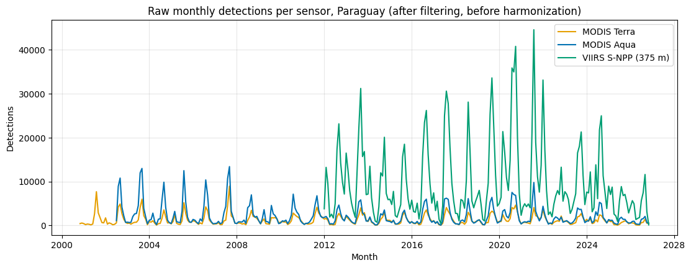
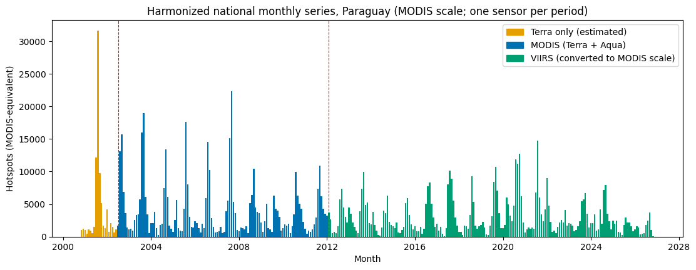
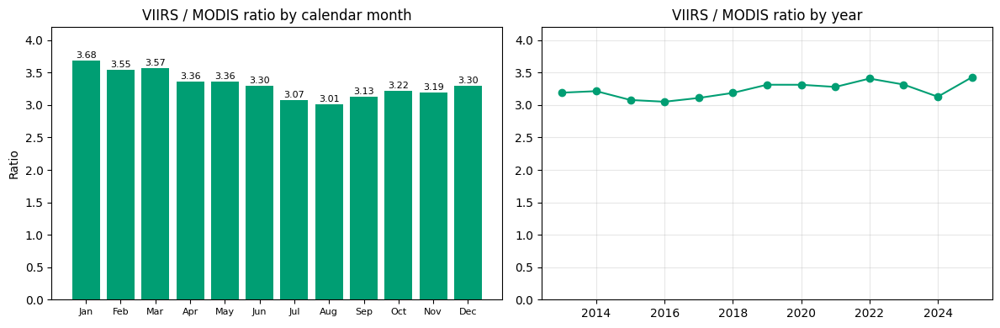
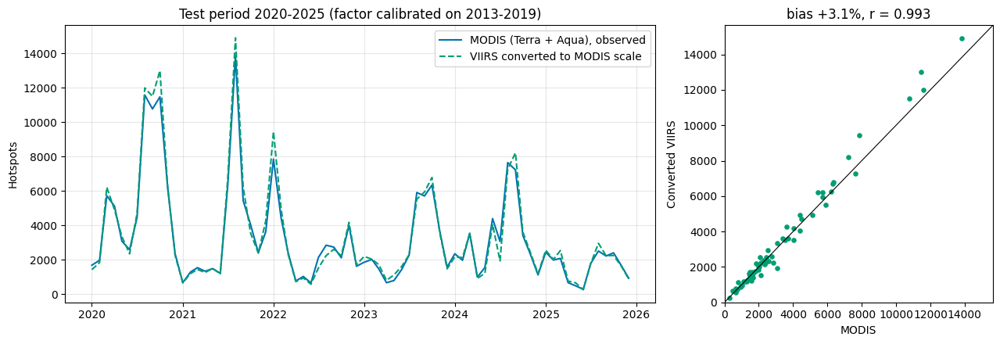
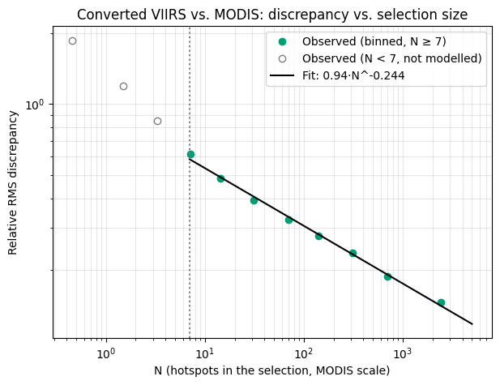
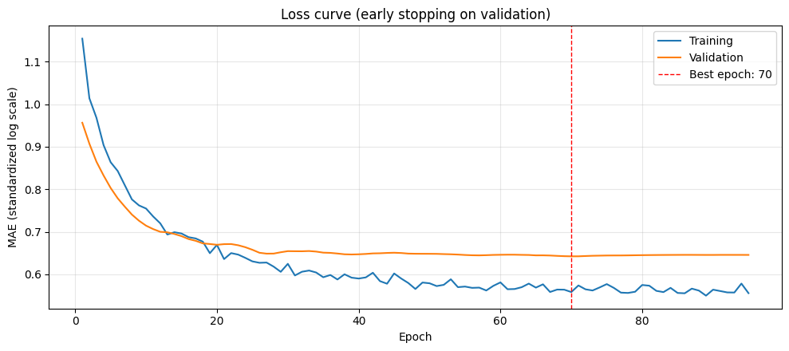
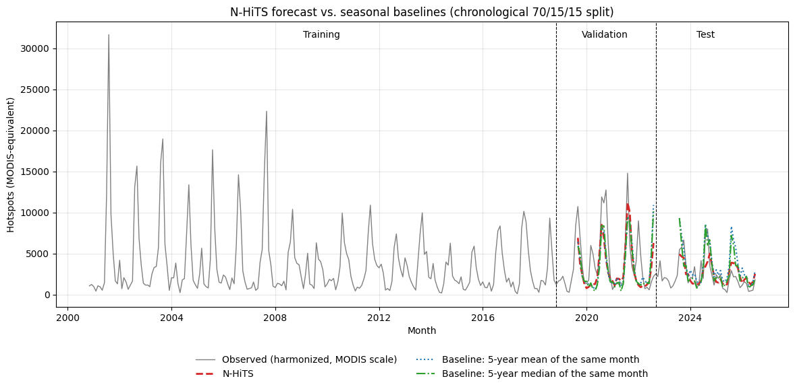

# Harmonized MODIS + VIIRS Hotspots — Paraguay

Submission to the **2026 NASA Space Apps Challenge** (Asunción, Paraguay) · Challenge: *Harmonization of MODIS and VIIRS Hot Spots*.

**Live application:** [Harmonized MODIS + VIIRS Hotspots — Paraguay](https://modis-viirs-hotspot-harmonization-eqpbw6rmhgl9wvpylkfgny.streamlit.app/)

> **Note:** The application is hosted on the free tier of Streamlit Community Cloud, which may put apps to sleep after a period without visitors. If you see a sleep screen, click **"Yes, get this app back up!"** and wait for the application to restart.

---

## What It Does

This project provides a web application that harmonizes MODIS (available since 2000) and VIIRS (available since 2012) active-fire detections into a consistent monthly hotspot time series for Paraguay.

By converting observations from different satellite sensors to a common MODIS-equivalent scale, the application enables a more consistent analysis of long-term fire activity, reducing discontinuities associated with changes in satellite instrumentation.

Users can select a rectangular area of interest (AOI) using latitude and longitude coordinates and define a monthly time range. The application provides:

- **Hotspot time series:** Monthly, quarterly, or yearly aggregation, including an uncertainty band and reliability flags.
- **Burning activity calendar:** Year × month visualization with two views: hotspot counts and anomalies relative to the historical median for the same calendar month. Values are displayed in every cell, using color-blind-friendly color scales.
- **Interactive globe:** Paraguay displays harmonized 0.25° grid cells. Other countries currently display "Coming soon".
- **CSV downloads:** Harmonized hotspot observations for the selected AOI (cell × month) and the corresponding aggregated time series.
- **Experimental national forecast:** A 12-month forecast of national hotspot activity for Paraguay.

**Current coverage:** Paraguay · 0.25° grid · November 2000 to November 2026.

---

## Methodology

### 1. Data Sources

The project uses active-fire observations downloaded from the NASA Fire Information for Resource Management System (FIRMS) archive:

- **MODIS Collection 6.1:** Terra and Aqua satellites.
- **VIIRS S-NPP Collection 2:** Suomi-NPP VIIRS, with a spatial resolution of 375 m.

Standard-processing archive files are used for historical observations, while near-real-time (NRT) files are used for the most recent months.

### 2. Filtering and Preprocessing

The following filters are applied:

- **MODIS:** Confidence ≥ 30 (nominal or high) and `type == 0` (presumed vegetation fire).
- **VIIRS:** Confidence `n` or `h` and `type == 0`.

Duplicate detections are removed. After filtering, 96.1% of MODIS and 91.5% of VIIRS archive detections are retained.

The following figure shows the monthly active-fire detections recorded by each satellite sensor over Paraguay, after filtering and before harmonization.



*Figure 1. Monthly raw active-fire detections by satellite sensor in Paraguay, before harmonization.*

### 3. Spatial Gridding

Each active-fire detection is assigned to a 0.25° spatial grid cell using the following indexing equations:

- `y = floor((90 − lat) / 0.25)`
- `x = floor((lon + 180) / 0.25)`

Detections are subsequently aggregated by grid cell, month, and satellite sensor.

### 4. Sensor Harmonization

To construct a consistent time series, the project uses one satellite source per period. The only transition between sensor sources occurs in February 2012.

The harmonization procedure consists of three periods:

1. **November 2000 – June 2002: Terra only (estimated).** Aqua observations are unavailable before July 2002. Terra detections are therefore scaled using the monthly `(Terra + Aqua) / Terra` ratio calculated from 2003–2004. These observations are flagged as estimated.

2. **July 2002 – January 2012: MODIS Terra + Aqua.** The observed combined MODIS detections are used directly.

3. **February 2012 onward: VIIRS converted to MODIS scale.** VIIRS detections are divided by a monthly calendar conversion factor (VIIRS/MODIS), calibrated over February 2012–December 2025. Depending on the calendar month, VIIRS records approximately 3.0 to 3.7 times as many detections as MODIS.

The resulting harmonized national series combines the available satellite observations into a consistent monthly time series expressed on the MODIS-equivalent scale.



*Figure 2. Harmonized national monthly hotspot series for Paraguay, expressed on the MODIS-equivalent scale. Different colors indicate the satellite source used in each period.*

The conversion factor varies across calendar months and years. The following analysis illustrates the observed VIIRS-to-MODIS detection ratio used in the calibration process.



*Figure 3. VIIRS/MODIS detection ratio by calendar month and year, calculated for 2013–2025.*

### 5. Harmonization Uncertainty

The relative discrepancy between converted VIIRS and MODIS observations is modeled as a function of the number of hotspots in the selected area.

The empirical relationship is:

`RMS ≈ 0.94 · N^−0.245`

where `N` represents the number of hotspots in the selection on the MODIS-equivalent scale.

The relationship was obtained through a log-log fit using observations with N ≥ 7. Selections with N < 7 are flagged as low reliability and displayed without an uncertainty error bar.

| N (hotspots) | 10 | 100 | 1,000 | 5,000 |
|---|---:|---:|---:|---:|
| Expected relative error | 54% | 31% | 17% | 12% |

The following figure illustrates the empirical relationship between selection size and the relative discrepancy between converted VIIRS and MODIS observations.



*Figure 4. Empirical uncertainty model showing the relative RMS discrepancy as a function of the number of hotspots in a spatial selection.*

---

## Validation of Harmonization

The monthly conversion factors were calibrated using observations from 2013–2019 and evaluated against independent observations from 2020–2025, years not used during calibration.

At the national level, the validation produced the following results:

| Metric | Value |
|---|---:|
| Total bias | +3.1% |
| Mean monthly error | 9.5% |
| Correlation | 0.993 |

Regional validation also showed consistent results:

| Region | Bias | Correlation |
|---|---:|---:|
| Western Chaco | +2.8% | 0.991 |
| Eastern region | −1.3% | 0.994 |

The following figure compares observed MODIS detections with VIIRS detections converted to the MODIS-equivalent scale during the independent 2020–2025 test period.



*Figure 5. Independent harmonization validation for 2020–2025, using conversion factors calibrated on 2013–2019 observations.*

---

## National Forecast (Experimental)

The application includes an experimental 12-month forecast of national hotspot activity for Paraguay.

The forecasting model is an **N-HiTS neural network** implemented in Keras, featuring:

- Multi-rate max-pooling.
- Hierarchical linear interpolation.
- Three network blocks.
- 23,001 parameters.

The model uses the last 36 complete months of the national harmonized time series. Provisional months are excluded. A `log1p` transformation is applied, with the scaler fitted exclusively on the training period. The model directly predicts the following 12 months.

The forecast is precomputed and does not depend on the AOI selected by the user in the application.

**Implementation:** `train_nhits.ipynb`.

### Model Training and Validation

A chronological 70/15/15 split was used:

| Partition | Period |
|---|---|
| Training | November 2000 – October 2018 |
| Validation | November 2018 – August 2022 |
| Test | September 2022 – July 2026 |

The validation set was used for early stopping, while the test set was not used for training.

Both validation and test performance were evaluated using non-overlapping 12-month prediction blocks. The model always receives the actual historical observations as input.

The reference method is a seasonal baseline calculated as the mean of the same calendar month over the previous five years.

The following figure shows the training and validation loss throughout model optimization. Early stopping was applied using validation loss.



*Figure 6. N-HiTS training and validation loss, showing the best epoch selected through early stopping.*

### Forecast Evaluation

The following table presents the performance of N-HiTS compared with the seasonal baseline.

| Split (evaluated months) | Model | MAE | RMSE | MAPE |
|---|---|---:|---:|---:|
| Validation (2019-09 to 2022-08) | N-HiTS | 2,155 | 2,992 | 55.2% |
| Validation (2019-09 to 2022-08) | Seasonal baseline | 2,429 | 3,337 | 67.6% |
| Test (2023-08 to 2026-07) | N-HiTS | 1,156 | 1,432 | 72.7% |
| Test (2023-08 to 2026-07) | Seasonal baseline | 1,467 | 1,903 | 97.0% |

The N-HiTS model achieved lower errors than the seasonal baseline in both evaluation periods:

- **Validation:** MAE was 11% lower than the baseline.
- **Test:** MAE was 21% lower than the baseline.

The following figure compares N-HiTS predictions with the seasonal baselines across the chronological training, validation, and test periods.



*Figure 7. N-HiTS predictions compared with seasonal mean and median baselines across the chronological evaluation periods.*

### Forecast Limitations

The forecasting results should be interpreted with caution:

- The test result is based on only three non-overlapping 12-month blocks from a single national time series, using one training run (seed 42) and no uncertainty intervals for the evaluation metrics.
- Relative errors are substantial (MAPE between 55% and 73%), partly because low-season months contain very few hotspots.
- The validation set was also used for early stopping, so validation metrics may be somewhat optimistic.
- The model deployed in the application is retrained on the complete time series and is therefore not exactly the same model used in the reported evaluation.
- The forecast does not include an uncertainty band. The uncertainty relationship described above applies to satellite sensor conversion, not to the forecasting model.

**The national forecast should be treated as experimental.**

---

## Limitations

Several limitations should be considered when interpreting the harmonized series and forecasting results:

- **Sensor disagreement is not ground-truth error.** The uncertainty model measures disagreement between converted VIIRS and MODIS observations. It does not measure error against actual fire occurrence.
- **Terra-only historical period:** The 20 months from November 2000 to June 2002 cannot be independently validated because Aqua observations are unavailable. The Terra+Aqua/Terra ratio decreased from 3.47 in 2003 to 2.48 in 2011. Consequently, the true ratio during the early period could be as high as or higher than the value used. No upper bound is known. Using ratios from later periods would make the estimated total for these months 14–19% lower.
- **Geographic scope:** Calibration and uncertainty modeling were evaluated only for Paraguay. Expanding the method to other regions requires recalibrating the monthly conversion factors and repeating the uncertainty analysis.
- **Spatial reliability:** Cell-level error is larger than national-level error because individual cells contain fewer hotspots per month. The N < 7 reliability flag addresses this limitation.
- **Cloud cover and missing observations:** Counts are not corrected for cloud cover or missing data.
- **Near-real-time data:** Observations from August 2026 onward come from NRT data and are provisional. November 2026 is incomplete.
- **VIIRS spatial resolution:** Converting VIIRS to the MODIS-equivalent scale does not exploit the full spatial detail available from VIIRS at 375 m.
- **Calibration overlap:** The absence of a discontinuity at February 2012 is partly true by construction because the calibration window includes 2012–2013. The independent evidence is provided by the 2020–2025 validation.

---

## Repository Contents

| File or directory | Purpose |
|---|---|
| `app.py` | Main Streamlit application |
| `globe.py` | Interactive globe visualization (Plotly) |
| `tabla_armonizada.csv` | Harmonized dataset (`cy`, `cx`, `mes`, `conteo_eq`, `origen`, `provisorio`); `origen` identifies the source of each value |
| `harmonization.ipynb` | Notebook that produces the harmonized table and uncertainty analysis |
| `train_nhits.ipynb` | Training and validation of the forecasting model |
| `models/nhits/` | Forecast model files and/or precomputed forecast (`forecast_nhits.csv`) |
| `make_forecast.py` | Script for precomputing the forecast, if used |
| `figures/` | Scientific figures and visualizations included in this README |
| `requirements.txt` | Python dependencies |

The `figures/` directory contains:

- `fig_raw_by_sensor.png`
- `fig_harmonized_series.png`
- `fig_ratio_viirs_modis.png`
- `fig_conversion_validation.png`
- `fig_error_law.png`
- `fig_loss_curve.png`
- `fig_forecast_validation.png`

**Grid cell centers:**

- `lat = 89.875 − 0.25 · cy`
- `lon = −179.875 + 0.25 · cx`

The harmonized table only contains cell-month combinations with at least one detection. Missing combinations are treated as zero from the beginning of each period. Column names are kept in Spanish because the application reads them directly.

---

## Run Locally

Clone the repository and install the required dependencies:

```bash
pip install -r requirements.txt
streamlit run app.py
```

---

## Reproducing the Harmonized Dataset

To reproduce the harmonized table:

1. Access the NASA FIRMS Archive Download service.
2. Select Paraguay as the country.
3. Request MODIS and VIIRS S-NPP observations.
4. Use the corresponding historical date ranges, starting from November 2000 for MODIS and January 2012 for VIIRS, through the latest available date.
5. Download the data in CSV format.
6. Run `harmonization.ipynb` to reproduce the processing, harmonization, and uncertainty analysis.

Raw FIRMS files are not included in this repository because of their size.

---

## Data Sources

- **NASA FIRMS (Fire Information for Resource Management System):** MODIS Collection 6.1 and VIIRS S-NPP active-fire data.
- **MODIS Collection 6 Active Fire Product User's Guide:** Reference for confidence classes and the `type` field.

---

## Use of AI Tools

AI assistance (Claude, by Anthropic) was used throughout this project for planning, writing, and debugging the data-processing code in the notebooks and Streamlit application, as well as for drafting this README.

The author executed the code, checked the outputs against the data, and made the methodological and design decisions. All numerical results reported in this README come from the notebook outputs.

---

## Reused Prior Work

None

---

## Team
tatAI by Francisco Moreno
